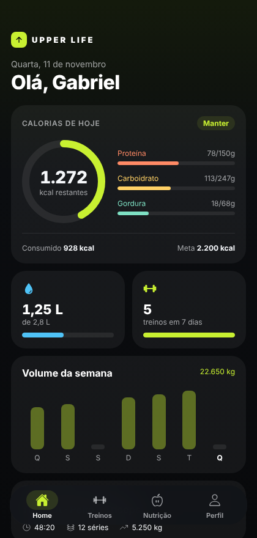

# UPPER LIFE

**Treino e nutrição num app só.** App mobile em React Native (Expo) para registrar o treino série por série e controlar calorias, macros e água com alimentos da Tabela TACO.

<p>
  
  
  
  
</p>

## O problema
Quem treina e faz dieta costuma usar dois ou três apps separados: um para anotar as séries, outro para contar calorias e outro para lembrar de beber água. Os apps de dieta mais conhecidos usam bases de alimentos estrangeiras, que não batem com a comida brasileira. O UPPER LIFE junta tudo numa tela, com metas calculadas pelo peso e pelo objetivo de cada pessoa.

## Funcionalidades
- **Home:** anel de calorias restantes, macros do dia, hidratação, treinos e volume da semana, último treino.
- **Treinos:** quatro treinos prontos (A, B, C e D) ou treino livre. Na sessão ativa:
  - cronômetro e campos de kg e reps por série;
  - descanso automático de 90 s depois de cada ✓;
  - "última vez" de cada exercício;
  - exercício personalizado;
  - volume (peso × reps) calculado ao vivo.
- **Nutrição:** busca na Tabela TACO, quantidade em gramas com macros proporcionais, quatro refeições e água com botões rápidos.
- **Perfil:** peso e objetivo (Cutting 1800, Manter 2200, Bulking 3000 ou Personalizado). As metas de proteína (2 g/kg), gordura (0,9 g/kg), carboidrato e água (35 ml/kg) são calculadas automaticamente.
- Os dados ficam salvos no aparelho com AsyncStorage. O botão **Carregar dados de exemplo** no Perfil serve para demonstrações.

## Como rodar
Pré-requisitos: Node.js LTS e o app **Expo Go** no celular.

```bash
git clone <url-deste-repositorio>
cd <pasta-do-repositorio>
npm install
npm run setup     # instala as dependências na versão certa para o SDK do Expo
npm start         # escaneie o QR code com o Expo Go
```

Se o Expo Go do celular disser que o SDK do projeto é incompatível, rode `npx expo install expo@<versão-do-seu-Expo-Go>` e depois `npm run setup` de novo. Se o QR code não conectar, use `npx expo start --tunnel`.

## Estrutura
```
App.js                      estado global, persistência e navegação entre abas
index.js                    ponto de entrada do Expo
src/
  telas/                    Home, Treinos, SessaoAtiva, Nutricao, Perfil
  componentes/
    ui.js                   cartão de vidro, barra, anel, botões, chips, folha (bottom sheet)
    BarraAbas.js            barra de navegação flutuante
    ModalAlimento.js        busca e porção de alimentos
    ModalExercicio.js       busca e criação de exercícios
  dados.js                  Tabela TACO, exercícios, treinos prontos e protocolos
  utils.js                  datas, cálculo de metas, macros e volume
  tema.js                   paleta de cores
  estilos.js                StyleSheet compartilhado
docs/prints/                capturas de tela
docs/APRESENTACAO.md        roteiro do vídeo e pitch da apresentação
```

## Stack
React Native · Expo · AsyncStorage · expo-linear-gradient · expo-blur · react-native-svg · Ionicons

## Próximos passos
- Login e sincronização na nuvem
- Histórico de peso corporal e gráficos de evolução por exercício
- Assistente de IA para sugerir treino e dieta

---
Valores nutricionais aproximados com base na Tabela Brasileira de Composição de Alimentos (TACO/UNICAMP).
